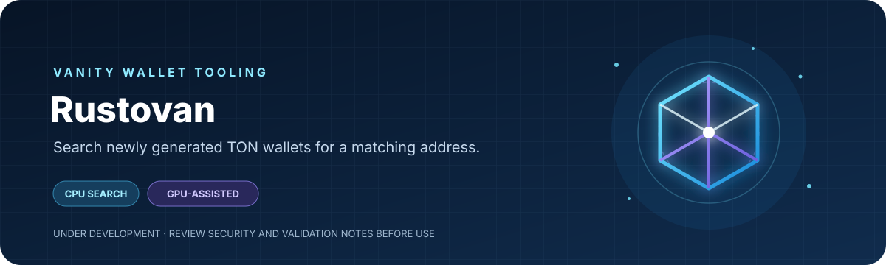
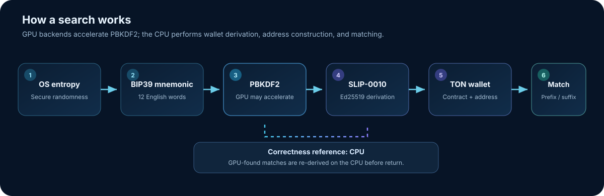

<div align="center">


[](https://www.rust-lang.org/)
[](#installation)
[](STATUS.md)
[](https://github.com/MinitorMHS/rustovan/releases)
[](https://github.com/MinitorMHS/rustovan/actions/workflows/rust.yml)
[](https://github.com/MinitorMHS/rustovan/releases)
[](https://github.com/MinitorMHS/rustovan/graphs/contributors)
[](https://github.com/MinitorMHS/rustovan/commits/main)
[](LICENSE)

**Search newly generated TON wallets for a matching address.**

CPU-first wallet derivation with optional GPU-assisted PBKDF2
acceleration.
</div>

> [!WARNING] **Under development --- not production-certified.**
> Review the [current readiness status](STATUS.md), [validation
> requirements](docs/validation.md), and [security policy](SECURITY.md)
> before relying on this project with funds. This README does not
> certify the implementation as secure.

## Overview

Rustovan is a command-line tool that searches newly generated 12-word
English BIP39 mnemonics for TON wallet addresses matching a prefix,
suffix, or exact address.

It supports CPU search and optional GPU-assisted PBKDF2 acceleration.
Wallet derivation, TON address construction, and address matching remain
on the CPU.

## Contents

-   [Features](#features)
-   [How it works](#how-it-works)
-   [Requirements](#requirements)
-   [Installation](#installation)
-   [Quick start](#quick-start)
-   [Use cases](#use-cases)
-   [Search options](#search-options)
-   [Backends and tuning](#backends-and-tuning)
-   [Background daemon](#background-daemon)
-   [Secret handling](#secret-handling)
-   [Build from source](#build-from-source)
-   [Release binaries](#release-binaries)
-   [Development and validation](#development-and-validation)
-   [Documentation](#documentation)
-   [License](#license)

## Features

  -----------------------------------------------------------------------
  Category                            Capabilities
  ----------------------------------- -----------------------------------
  **Wallet contracts**                V1R1--V5R1/W5 and Telegram WalletTg

  **Wallet derivation**               BIP39 12-word mnemonics and TON
                                      SLIP-0010 Ed25519 derivation

  **Address formats**                 Mainnet and testnet; bounceable and
                                      non-bounceable friendly formats

  **Search criteria**                 Repeatable prefix, suffix, and
                                      exact-address criteria

  **Match modes**                     `all` and `any`

  **Compute backends**                CPU, GPU-assisted, Hybrid, and
                                      Auto; availability depends on
                                      platform and driver

  **Operations**                      Optional background daemon and
                                      multi-device search

  **Encrypted export**                Optional age-encrypted output
                                      builds
  -----------------------------------------------------------------------

## How it works

<div align="center">

</div>

The CPU is the correctness reference. GPU backends accelerate **PBKDF2
only**. Key derivation, public-key generation, wallet construction,
address encoding, and matching run on the CPU.

Any match found through a GPU-assisted route is re-derived on the CPU
before the wallet is returned.

## Requirements

-   **Windows:** PowerShell 5.1 or newer and an internet connection.
-   **Linux, macOS, and Termux:** Bash, `curl`, Python 3, and `tar`.
    Package verification also requires `sha256sum` or `shasum`.
-   **Termux dependencies:** install the required utilities with
    `pkg install curl python tar coreutils`.

The installer downloads the package matching your operating system and
architecture from the latest GitHub release.

## Installation

The installers download the appropriate package from the latest stable
GitHub release, verify it against the release's `SHA256SUMS.txt`
manifest, and add `rustovan` to your user `PATH`. Administrator
privileges are not required.

### Linux, macOS, and Termux

``` bash
curl -fsSL https://raw.githubusercontent.com/MinitorMHS/rustovan/main/install.sh | bash
```

The Bash installer supports Termux on ARM64.

### Windows

Run the following in PowerShell 5.1 or newer:

``` powershell
irm https://raw.githubusercontent.com/MinitorMHS/rustovan/main/install.ps1 | iex
```

### Verify the installation

Open a new terminal so it picks up the updated `PATH`, then run:

``` sh
rustovan --help
rustovan --version
```

The installer places the executable in:

-   **Linux, macOS, and Termux:** `~/.local/bin`
-   **Windows:** `%LOCALAPPDATA%\Programs\Rustovan\bin`

### Update

Run the same installation command again. The installer checks release
metadata and local hashes before downloading and installing an update.

The `rustovan` command does not check for updates when it runs.

### Uninstall

Linux, macOS, and Termux:

``` bash
curl -fsSL https://raw.githubusercontent.com/MinitorMHS/rustovan/main/install.sh | bash -s -- uninstall
```

Windows PowerShell:

``` powershell
& ([scriptblock]::Create((irm https://raw.githubusercontent.com/MinitorMHS/rustovan/main/install.ps1))) uninstall
```

### Installation security

The installer checks the package against the SHA-256 manifest published
in the same release. New releases from the workflow publish a detached
OpenPGP signature for that manifest after release signing is configured.
The installer does not yet verify the signature automatically; manual
signature verification requires the release public key and a fingerprint
obtained independently of the release assets.

The commands above execute the current installer from the repository's
`main` branch. Review [install.sh](install.sh) or
[install.ps1](install.ps1) before running them if you want to inspect
the installation process first.

The installer reports an error if the latest release does not include a
package for the detected target. See [Release
binaries](#release-binaries) for platform coverage.

## Quick start

### 1. Run a CPU smoke search

The default non-bounceable mainnet address header starts with `U`, so
this should return immediately:

``` sh
rustovan --backend cpu --wallet v4r2 --prefix U
```

### 2. Search for a vanity suffix

Replace `yyy` with the suffix you want to find:

``` sh
rustovan --backend auto --wallet v5r1 --suffix yyy
```

### 3. Export wallet credentials

By default, Rustovan prints the address but withholds the mnemonic and
private key. To save wallet credentials, specify a new output file:

``` sh
rustovan --backend auto --wallet v5r1 --suffix yyy --output ./wallet-secrets.txt
```

> [!CAUTION] `--output` writes **plaintext wallet credentials**. Use a
> trusted machine and protect the file. Existing files are never
> overwritten.
>
> Without `--output` or `--show-secrets`, generated wallet credentials
> are not recoverable. `--show-secrets` prints credentials to stdout,
> where terminal recording or shell logs may capture them.

The text export begins with `format=rustovan-wallet-export-v1` and records
the wallet version, network, bounceability, account, derivation path, and
whether a BIP39 passphrase was set. It never stores the passphrase itself;
when `bip39_passphrase_set=true`, you must keep the exact passphrase with
your recovery backup. The export also records the format of the 32-byte
Ed25519 private-key seed in hexadecimal.

## Use cases

### CPU-only search

Use the CPU backend when you do not want to use GPU drivers or
GPU-assisted PBKDF2:

``` sh
rustovan --backend cpu --wallet v5r1 --suffix yyy --output ./wallet-secrets.txt
```

### Automatic backend selection

`auto` measures the available CPU and GPU-assisted routes, then selects
the fastest route measured for the current run:

``` sh
rustovan --backend auto --wallet v5r1 --prefix yyy --output ./wallet-secrets.txt
```

### Search multiple patterns

Repeat `--prefix`, `--suffix`, or `--exact` to provide multiple
criteria.

With `any`, the search stops when the first criterion matches:

``` sh
rustovan --wallet v5r1 --prefix alpha --suffix omega --match-mode any --output ./wallet-secrets.txt
```

With `all`, Rustovan searches for a separate wallet for each criterion:

``` sh
rustovan --wallet v5r1 --prefix alpha --suffix omega --match-mode all --output ./wallet-secrets.txt
```

Use `--max-candidates` when searching exact addresses. Exact search is a
random search; it cannot target a wallet directly.

### Inspect devices and performance

``` sh
rustovan devices
rustovan threads
rustovan benchmark
```

## Search options

  -----------------------------------------------------------------------
  Option                              Description
  ----------------------------------- -----------------------------------
  `--wallet`                          Select `v1r1`, `v1r2`, `v1r3`,
                                      `v2r1`, `v2r2`, `v3r1`, `v3r2`,
                                      `v4r1`, `v4r2`, `v5r1`/`w5`, or
                                      `wallettg`. Default: `v5r1`.

  `--prefix`, `--suffix`, `--exact`   Set an address criterion. Exact
                                      addresses must be 48-character
                                      friendly addresses. Repeat a flag
                                      to add criteria.

  `--match-mode all` /                `all` (default) searches for a
  `--match-mode any`                  distinct wallet per criterion;
                                      `any` stops after the first
                                      criterion matches.

  `--case-sensitive`                  Make prefix and suffix comparisons
                                      case-sensitive. Exact addresses are
                                      always byte-exact.

  `--bounceable`, `--testnet`         Select friendly-address flags and
                                      network.

  `--account N`                       Select the hardened path
                                      `m/44'/607'/N'`. For W5, `N` is
                                      also its subwallet number.

  `--prompt-passphrase`               Prompt for a hidden BIP39
                                      passphrase. It changes the derived
                                      wallet; it does not encrypt the
                                      mnemonic.

  `--max-candidates N`                Stop after `N` generated
                                      candidates. Required for `--exact`.

  `--output PATH`, `--show-secrets`   Choose a secret export method.
                                      `--output` creates a file;
                                      `--show-secrets` prints credentials
                                      to stdout.
  -----------------------------------------------------------------------

Prefix text is matched after the friendly-address header. For example,
on default mainnet non-bounceable addresses, `--prefix yyy` searches for
`UQyyy`; with `--bounceable`, it searches for `EQyyy`. Testnet headers
are `0Q` (non-bounceable) and `kQ` (bounceable).

Prefix and suffix matching is case-insensitive by default. To search for
a suffix beginning with a hyphen, use `--suffix=-xxx`.

If a prefix already contains a recognized header (`UQ`, `EQ`, `0Q`, or
`kQ`), it must match the selected network and bounceability mode. Rustovan
rejects conflicting headers instead of beginning a search that cannot
match. Exact addresses are also checked against the selected header and
generated workchain before search. Exact searches require
`--max-candidates` because random wallet generation cannot feasibly target
an arbitrary address directly.

### WalletTg limitations

WalletTg uses a fixed mainnet derivation with account 0 and an empty
BIP39 passphrase. Nonzero `--account`, a non-empty passphrase, and
`--testnet` are not supported for WalletTg.

Importing an existing mnemonic and WalletTg key rotation are not
implemented. If you use a BIP39 passphrase with another wallet version,
keep it with your recovery backup: restoring requires the same mnemonic
and passphrase.

For the complete command reference:

``` sh
rustovan --help
```

## Backends and tuning

  -----------------------------------------------------------------------
  Backend                             Behavior
  ----------------------------------- -----------------------------------
  `cpu`                               Runs candidate generation and
                                      wallet derivation on the CPU.

  `auto`                              Default. For short finite searches
                                      it uses a CPU fast path. Otherwise,
                                      it measures CPU-only, GPU-only, and
                                      concurrent CPU+GPU routes, then
                                      selects the fastest measured route.

  `hybrid`                            Benchmarks available GPU routes and
                                      CPU worker configurations, then
                                      searches with CPU and GPU lanes
                                      running concurrently.

  `opengl`, `opencl`, `vulkan`,       Request a specific GPU backend.
  `dx12`, `dx11`, `metal`, `cuda`     Availability depends on the target
                                      OS, build features, GPU, and
                                      driver. CUDA requires an opt-in
                                      build.
  -----------------------------------------------------------------------

Calibration uses deterministic public test candidates, not random wallet
candidates, and does not save wallet credentials. Measurements are
estimates: device load and thermal state can change which route is
fastest.

See the [validation notes](docs/validation.md) for hardware-specific
results and remaining checks.

### Useful diagnostic commands

``` sh
rustovan devices
rustovan capabilities
rustovan threads
rustovan benchmark
rustovan gpu-self-test --backend opengl
```

### Performance controls

-   `--threads 0` uses the available logical CPU threads.
-   `--gpu-batch 0` lets the program derive a device limit and tune its
    dispatch size. A positive value caps the tuning and dispatch size.
-   `--gpu-devices N` requests multiple compatible devices. Additional
    devices must pass PBKDF2 parity checks before receiving work.

Multi-device search is not implemented for Direct3D 11 or CUDA.

Hybrid mode keeps the configured CPU search pool and tunes a separate
CPU pool for processing GPU results. As a result, the total CPU worker
count can exceed `--threads`.

## Background daemon

The daemon supports one background search at a time. Search options
follow `daemon start`:

``` sh
rustovan daemon start --wallet v4r2 --backend auto --suffix yyy --output ./wallet.txt
rustovan daemon status
rustovan daemon stop
```

These commands work on Windows, Linux, macOS, and Termux.

Without `--output`, the daemon warns that a found mnemonic and private
key will be withheld and cannot be recovered from its log. Daemon mode
rejects `--show-secrets`.

## Secret handling

### Age-encrypted output

The optional `sealed-output` build embeds an age public recipient at
compile time. It rejects `--show-secrets` and writes encrypted results.

A default sealed build is CPU-only, so mnemonic and passphrase inputs
stay off GPU devices and drivers. The public recipient is embedded in
the executable and is not secret. Keep the matching private identity
secure.

PowerShell example using a classic age X25519 identity:

``` powershell
age-keygen -o .\my-age-identity.txt
$env:TON_VANITY_AGE_RECIPIENT = (age-keygen -y .\my-age-identity.txt).Trim()
cargo build --release --locked --no-default-features --features cpu,sealed-output --target-dir .\target-sealed
Remove-Item Env:TON_VANITY_AGE_RECIPIENT
```

Run the sealed binary with `--output .\result.age`, then decrypt with
the matching identity:

``` powershell
age -d -i .\my-age-identity.txt .\result.age > .\wallet-secrets.txt
```

The embedded Rust age library accepts classic X25519 recipients and
tagged post-quantum hardware recipients (`age1tagpq1...`). Standard
software `age1pq1...` recipients are rejected.

`sealed-output-gpu` opts into GPU use and warns that GPU devices and
drivers receive mnemonic/passphrase-derived inputs.

Sealed output protects the result file at rest; it cannot make an
untrusted host safe or prevent inspection of process memory. See
[SECURITY.md](SECURITY.md).

## Build from source

### Build requirements

-   **All platforms:** stable Rust and Cargo.

-   **Windows:** the MSVC Rust toolchain and Visual Studio C++ Build
    Tools.

-   **Linux:** C build tools, `pkg-config`, and OpenSSL development
    headers. On Debian or Ubuntu:

    ``` sh
    sudo apt-get update
    sudo apt-get install -y build-essential pkg-config libssl-dev
    ```

-   **macOS:** Xcode Command Line Tools, Homebrew, `openssl@3`, and
    `pkg-config`.

-   **GPU acceleration:** a compatible GPU and runtime driver. CPU mode
    does not require a GPU.

### Default build

``` sh
cargo build --release --locked
```

### macOS: configure Homebrew OpenSSL

``` sh
brew install openssl@3 pkg-config
export OPENSSL_DIR="$(brew --prefix openssl@3)"
export PKG_CONFIG_PATH="$OPENSSL_DIR/lib/pkgconfig"
cargo build --release --locked
```

### CPU-only build

Use this configuration to omit GPU backends:

``` sh
cargo build --release --locked --no-default-features --features cpu
```

### Termux / Android

Termux is not limited to CPU mode. A native default-feature build
includes the same GPU backend features as other default builds; whether
a backend can run depends on the phone's GPU driver and runtime.

This project has been exercised with Vulkan and OpenGL on Termux. The
GitHub Actions Android ARM64 artifact uses the default Cargo feature set
as well, plus `android-cross` for its Android OpenSSL build.

The release binary targets Android API 30 (Android 11) because the
Android linker needs `renameat2`; it will not run on older Android
releases. The workflow cannot verify GPU runtime behavior on a phone.

Install native dependencies first:

``` sh
pkg install rust clang openssl pkg-config
```

### CUDA (opt-in)

The default feature set enables CPU search, OpenGL/GLES, Vulkan, OpenCL,
and Windows Direct3D 11, as well as wgpu's platform-specific Direct3D 12
and Metal backends.

CUDA is opt-in and requires the CUDA Toolkit and `nvcc`:

``` sh
cargo build --release --locked --features cuda
```

## Release binaries

Download the package for your operating system and architecture from
[GitHub Releases](https://github.com/MinitorMHS/rustovan/releases). Releases
created after release signing is configured include `SHA256SUMS.txt` and
the detached signature `SHA256SUMS.txt.asc`.

After importing the Rustovan release public key, check its full
fingerprint against a value published through a separate trusted channel.
Then verify the manifest signature and the package checksum:

``` sh
gpg --verify SHA256SUMS.txt.asc SHA256SUMS.txt
sha256sum --check SHA256SUMS.txt
```

On Windows, use `Get-FileHash -Algorithm SHA256` to compare a package hash
with its entry in the verified manifest.

### Supported release targets

The release workflow builds:

-   **Windows:** x86_64 and ARM64 (`rustovan.exe`)
-   **Linux glibc:** amd64, ARM64, hard-float ARMv7, and RV64GC
-   **Linux musl:** amd64 and ARM64
-   **macOS:** Intel and Apple Silicon
-   **Android / Termux:** ARM64

The musl packages are separate from the glibc Linux packages. Linux
cross-target builds use the `cross-openssl` feature to build OpenSSL for
their target. Android uses `android-cross` and targets Android API 30 or
newer. Other targets use Cargo's default backend features.

Backend availability still depends on the target OS, GPU, and runtime
libraries. Android GPU runtime behavior requires testing on physical
devices.

### Publishing a release (maintainers)

To build and publish a release, run [Build and release
binaries](.github/workflows/release.yml) manually from GitHub Actions
and set `tag_name` to an unused stable version tag, such as `v1.0.0`.

The workflow stamps the version into `Cargo.toml` and `Cargo.lock` in
its temporary runner checkout before compiling. This makes
`rustovan --version` report the release version without changing the
repository's committed files.

Set `publish_release: false` to build and upload platform artifacts
without creating a GitHub release. GitHub Actions must be allowed to
create releases with `contents: write` when publishing.

The published v0.1.0 release predates the expanded build matrix and the
`rustovan` executable name. Its archives use the older `ton-vanity-rust`
name and cover Windows x86_64, Linux x86_64 and ARM64, macOS x86_64 and
ARM64, and Android ARM64. The installer recognizes those legacy archive
names and installs the executable as `rustovan`. A new release is needed
to publish the expanded target matrix under the renamed project.

## Development and validation

Run the project tests and formatting checks:

``` sh
cargo test --locked
cargo fmt --all -- --check
cargo check --locked
```

The CI workflow also checks the CPU-only build, compiles the default
configuration, runs an independent TON address cross-check, and builds
release binaries.

GPU runtime correctness still requires `gpu-self-test` on the target
device and driver. The [validation guide](docs/validation.md) lists
current checks; [STATUS.md](STATUS.md) tracks platform coverage and
production-readiness gaps.

## Documentation

-   [Wallet contract registry](contracts/registry.md)
-   [Production-readiness plan](RELEASE_PLAN.md)
-   [Build notes](BUILD_NOTES.md)
-   [Validation strategy](docs/validation.md)
-   [GPU roadmap](docs/gpu-roadmap.md)
-   [Shader kernel notes](shaders/README.md)
-   [CUDA backend notes](cuda/README.md)
-   [Dependency license inventory](docs/dependency-license-inventory.md)
-   [Security policy](SECURITY.md)
-   [Current readiness status](STATUS.md)

## License

Rustovan is licensed under the GNU General Public License v3.0. You may use, modify, and redistribute it under the terms of the license. If you distribute Rustovan or modified versions, you must comply with the GPL-3.0 requirements. See [LICENSE](LICENSE) for the full license text.

------------------------------------------------------------------------

<div align="center">
**Rustovan** · Search locally. Validate carefully. Protect your secrets.
</div>
