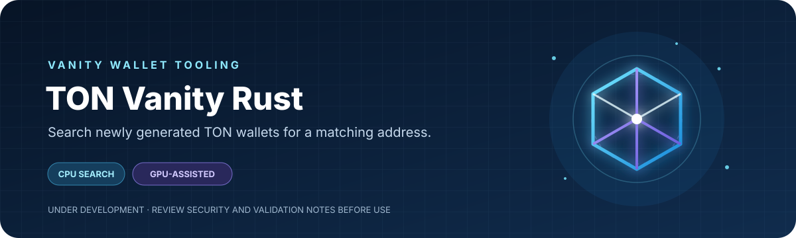

<div align="center">



[](https://www.rust-lang.org/)
[](#build)
[](STATUS.md)

**Search newly generated TON wallets for a matching address.**

CPU-first wallet derivation with optional GPU-assisted PBKDF2 acceleration.

</div>

> [!WARNING]
> **Under development — not production-certified.** Review [current readiness status](STATUS.md), the [validation requirements](docs/validation.md), and [security policy](SECURITY.md) before relying on this project with funds. This README does not certify the implementation as secure.

## Overview

TON Vanity Rust is a command-line wallet generator that searches newly created 12-word English BIP39 mnemonics for TON addresses matching a prefix, suffix, or exact address. It supports CPU search and GPU-assisted PBKDF2; wallet derivation, TON address construction, and matching remain on the CPU.

## Contents

- [Overview](#overview)
- [Features](#features)
- [How it works](#how-it-works)
- [Build](#build)
- [Quick start](#quick-start)
- [Search options](#search-options)
- [Backends and tuning](#backends-and-tuning)
- [Background daemon](#background-daemon)
- [Secret handling](#secret-handling)
- [Release binaries](#release-binaries)
- [Development and validation](#development-and-validation)
- [Project documentation](#project-documentation)

## Features

| Capability | Details |
|---|---|
| **Wallet contracts** | V1R1–V5R1/W5 and Telegram WalletTg |
| **Wallet derivation** | BIP39 12-word mnemonic generation and TON SLIP-0010 Ed25519 derivation |
| **Address formats** | Mainnet and testnet; bounceable and non-bounceable friendly formats |
| **Search criteria** | Repeatable prefix, suffix, and exact-address criteria |
| **Match modes** | `all` and `any` matching |
| **Compute backends** | CPU, GPU-assisted, Hybrid, and Auto; availability depends on platform and driver |
| **Operations** | Optional background daemon and multi-device search |
| **Encrypted export** | Optional age-encrypted output builds |

## How it works

<div align="center">

</div>

The CPU is the correctness reference. GPU backends accelerate **PBKDF2 only**; key derivation, public-key generation, wallet construction, address encoding, and matching run on the CPU. A GPU-found match is re-derived on the CPU before its wallet is returned.

## Build

### Requirements

- Stable Rust and Cargo.
- **Windows:** the MSVC Rust toolchain and Visual Studio C++ Build Tools.
- **Linux:** C build tools, `pkg-config`, and OpenSSL development headers. On Debian or Ubuntu:

  ```sh
  sudo apt-get update
  sudo apt-get install -y build-essential pkg-config libssl-dev
  ```

- **macOS:** Xcode Command Line Tools, Homebrew, `openssl@3`, and `pkg-config`.
- **GPU acceleration:** a compatible GPU and runtime driver. CPU mode does not require a GPU.

### Default build

```sh
cargo build --release --locked
```

### macOS: configure Homebrew OpenSSL

```sh
brew install openssl@3 pkg-config
export OPENSSL_DIR="$(brew --prefix openssl@3)"
export PKG_CONFIG_PATH="$OPENSSL_DIR/lib/pkgconfig"
cargo build --release --locked
```

### Optional CPU-only build

Use this if you want to omit GPU backends:

```sh
cargo build --release --locked --no-default-features --features cpu
```

### Termux / Android

Termux is not limited to CPU mode. A native default-feature build includes the same GPU backend features as other default builds; whether a backend can run depends on the phone's GPU driver and runtime. This project has been exercised with Vulkan and OpenGL on Termux. The GitHub Actions Android ARM64 artifact uses the default Cargo feature set as well, plus `android-cross` for its Android OpenSSL build. That release binary targets Android API 30 (Android 11) because the Android linker needs `renameat2`; it will not run on older Android releases. The workflow cannot verify GPU runtime behavior on a phone.

Install native dependencies first:

```sh
pkg install rust clang openssl pkg-config
```

### CUDA (opt-in)

The default feature set enables CPU search, OpenGL/GLES, Vulkan, OpenCL, and Windows Direct3D 11, as well as wgpu's platform-specific Direct3D 12 and Metal backends. CUDA is opt-in and requires the CUDA Toolkit and `nvcc`:

```sh
cargo build --release --locked --features cuda
```

## Quick start

### 1. Run a CPU smoke search

The default non-bounceable mainnet address header starts with `U`, so this should return immediately:

```sh
cargo run --release --locked -- --backend cpu --wallet v4r2 --prefix U
```

### 2. Search for a vanity suffix

Replace `yyy` with the pattern you want to find:

```sh
cargo run --release --locked -- --backend auto --wallet v5r1 --suffix yyy
```

### 3. Export credentials only when you need them

By default, the program prints the address and withholds the mnemonic and private key. To retain a usable wallet, write credentials to a new file:

```sh
cargo run --release --locked -- --backend auto --wallet v5r1 --suffix yyy --output ./wallet-secrets.txt
```

> [!CAUTION]
> `--output` writes **plaintext wallet credentials**. Use a trusted machine and protect the file; existing files are never overwritten. Without `--output` or `--show-secrets`, generated wallet credentials are not recoverable. `--show-secrets` prints them to stdout, where terminal recording or shell logs may capture them.

## Search options

| Option | Behavior |
|---|---|
| `--wallet` | Select `v1r1`, `v1r2`, `v1r3`, `v2r1`, `v2r2`, `v3r1`, `v3r2`, `v4r1`, `v4r2`, `v5r1`/`w5`, or `wallettg`. Default: `v5r1`. |
| `--prefix`, `--suffix`, `--exact` | Set an address criterion. Exact addresses must be 48-character friendly addresses. Repeat a flag to add criteria. |
| `--match-mode all` / `--match-mode any` | `all` (default) searches for a distinct wallet per criterion; `any` stops after the first criterion matches. |
| `--case-sensitive` | Make prefix and suffix comparisons case-sensitive. Exact addresses are always byte-exact. |
| `--bounceable`, `--testnet` | Select friendly-address flags and network. |
| `--account N` | Select the hardened path `m/44'/607'/N'`. For W5, `N` is also its subwallet number. |
| `--prompt-passphrase` | Prompt for a hidden BIP39 passphrase. It changes the derived wallet; it does not encrypt the mnemonic. |
| `--max-candidates N` | Stop after `N` generated candidates. Required for `--exact`. |
| `--output PATH`, `--show-secrets` | Choose a secret export method. `--output` creates a file; `--show-secrets` prints to stdout. |

Prefix text is matched after the friendly-address header. For example, on default mainnet non-bounceable addresses, `--prefix yyy` searches for `UQyyy`; with `--bounceable`, it searches for `EQyyy`. Testnet headers are `0Q` (non-bounceable) and `kQ` (bounceable). If the prefix already contains a recognized header (`UQ`, `EQ`, `0Q`, or `kQ`), it is used as supplied. Prefix and suffix matching is case-insensitive by default. To search for a suffix beginning with a hyphen, write `--suffix=-xxx`. Exact searches require `--max-candidates` because random wallet generation cannot feasibly target an arbitrary address directly.

WalletTg uses a fixed mainnet derivation with account 0 and an empty BIP39 passphrase. Nonzero `--account`, a non-empty passphrase, and `--testnet` are not supported for WalletTg. Importing an existing mnemonic and WalletTg key rotation are not implemented. If you use a BIP39 passphrase with another wallet version, keep it with your recovery backup: restoring requires the same mnemonic and passphrase.

For complete option help:

```sh
cargo run --release --locked -- --help
```

## Backends and tuning

| Backend | Search behavior |
|---|---|
| `cpu` | Runs candidate generation and wallet derivation on the CPU. |
| `auto` | Default. For short finite searches it uses a CPU fast path; otherwise it measures CPU-only, GPU-only, and concurrent CPU+GPU routes and selects the fastest measured route. |
| `hybrid` | Benchmarks available GPU routes and CPU worker configurations, then searches with CPU and GPU lanes running concurrently. |
| `opengl`, `opencl`, `vulkan`, `dx12`, `dx11`, `metal`, `cuda` | Request a specific GPU backend. Availability depends on the target OS, build features, GPU, and driver. CUDA requires an opt-in build. |

Calibration uses deterministic public test candidates, not random wallet candidates, and does not save wallet credentials. Measurements are estimates: device load and thermal state can change the fastest route. See [validation notes](docs/validation.md) for hardware-specific results and remaining checks.

Useful commands:

```sh
cargo run --release --locked -- devices
cargo run --release --locked -- capabilities
cargo run --release --locked -- threads
cargo run --release --locked -- benchmark
cargo run --release --locked -- gpu-self-test --backend opengl
```

`--threads 0` uses the available logical CPU threads. `--gpu-batch 0` lets the program derive a device limit and tune its dispatch size; a positive value caps the tuning and dispatch size. `--gpu-devices N` requests multiple compatible devices; additional devices must pass PBKDF2 parity checks before receiving work. Multi-device search is not implemented for Direct3D 11 or CUDA. Hybrid keeps the configured CPU search pool and tunes a separate CPU pool for processing GPU results, so the total CPU worker count can exceed `--threads`.

## Background daemon

The daemon supports one background search at a time. Search options follow `daemon start`:

```powershell
target\release\ton-vanity-rust.exe daemon start --wallet v4r2 --backend auto --suffix yyy --output .\wallet.txt
target\release\ton-vanity-rust.exe daemon status
target\release\ton-vanity-rust.exe daemon stop
```

On Linux and macOS, use `./target/release/ton-vanity-rust` in place of the Windows executable path. Without `--output`, the daemon warns that a found mnemonic and private key will be withheld and cannot be recovered from its log. Daemon mode rejects `--show-secrets`.

## Secret handling

### Age-encrypted output

The optional `sealed-output` build embeds an age public recipient at compile time. It rejects `--show-secrets` and writes encrypted results. A default sealed build is CPU-only, so mnemonic and passphrase inputs stay off GPU devices and drivers. The public recipient is embedded in the executable and is not secret; keep the matching private identity secure.

PowerShell example using a classic age X25519 identity:

```powershell
age-keygen -o .\my-age-identity.txt
$env:TON_VANITY_AGE_RECIPIENT = (age-keygen -y .\my-age-identity.txt).Trim()
cargo build --release --locked --no-default-features --features cpu,sealed-output --target-dir .\target-sealed
Remove-Item Env:TON_VANITY_AGE_RECIPIENT
```

Run the sealed binary with `--output .\result.age`, then decrypt with the matching identity:

```powershell
age -d -i .\my-age-identity.txt .\result.age > .\wallet-secrets.txt
```

The embedded Rust age library accepts classic X25519 recipients and tagged post-quantum hardware recipients (`age1tagpq1...`). Standard software `age1pq1...` recipients are rejected. `sealed-output-gpu` opts into GPU use and warns that GPU devices and drivers receive mnemonic/passphrase-derived inputs. Sealed output protects the result file at rest; it cannot make an untrusted host safe or prevent inspection of process memory. See [SECURITY.md](SECURITY.md).

## Release binaries

After a release has been published, download the binary package for your operating system and architecture from this repository's GitHub Releases page. Each release also includes `SHA256SUMS.txt` so you can verify the downloaded package.

Run [Build and release binaries](.github/workflows/release.yml) manually from GitHub Actions. The required `tag_name` must match the version in `Cargo.toml`—for example, version `0.1.0` requires `v0.1.0`—and must not already exist.

The workflow is configured to build Windows x64, Linux x64 and ARM64, macOS Intel and Apple Silicon, and Android/Termux ARM64 packages, then publish SHA-256 checksums. Every target uses Cargo's default backend features; the Android cross-build additionally enables `android-cross` to bundle OpenSSL and targets Android API 30 or newer. Which backends can run still depends on the target OS, GPU, and runtime libraries. Use `publish_release: false` to build and upload platform artifacts without creating a GitHub release. Android GPU runtime behavior still needs device testing. GitHub Actions must be allowed to create releases with `contents: write` when publishing.

## Development and validation

Run project tests and formatting checks:

```sh
cargo test --locked
cargo fmt --all -- --check
cargo check --locked
```

The CI workflow also checks the CPU-only build, compiles the default configuration, runs an independent TON address cross-check, and builds release binaries. GPU runtime correctness still requires `gpu-self-test` on the target device and driver. The [validation guide](docs/validation.md) lists the current checks; [STATUS.md](STATUS.md) tracks platform and production-readiness gaps.

## Project documentation

- [Wallet contract registry](contracts/registry.md)
- [GPU roadmap](docs/gpu-roadmap.md)
- [Dependency license inventory](docs/dependency-license-inventory.md)
- [Security policy](SECURITY.md)
- [Current readiness status](STATUS.md)

---

<div align="center">

**TON Vanity Rust** · Search locally. Validate carefully. Protect your secrets.

</div>

